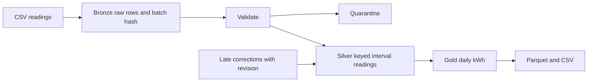

# Smart Meter Medallion Pipeline

An executable local data-engineering reference inspired by my utility-data work. It transforms synthetic interval energy readings into daily usage marts and demonstrates raw lineage, quarantine, idempotent batch loads, and late corrections.

## Architecture



## Run

Python 3.12, no cloud credentials or Java:

```bash
python -m pip install -r requirements.txt
python demo.py
python -m unittest discover -s tests -v
```

Expected final mart: `m001 = 4.0 kWh`, `m002 = 3.0 kWh` on 2026-01-01. The first load records six bronze rows, three distinct valid readings, and two rejected rows. The correction updates an interval to revision 2; the subsequent stale revision cannot overwrite it. Repeat the demo to observe batch replay protection.

## Data semantics

`kwh` is interval consumption, not a cumulative meter counter. `(meter_id, event_time)` identifies an interval. Revision is supplied by the source; only a higher revision replaces a reading. Daily aggregation uses UTC. A source with local billing-day rules needs a timezone dimension and daylight-saving tests. Accepted count measures valid source rows, including duplicate interval rows; silver count measures unique intervals.

## Why DuckDB here

DuckDB and Parquet make the design reproducible on a laptop. This implementation does not run Spark, Delta Lake, streaming ingestion, or Unity Catalog. My professional Databricks experience motivated the design; this repository demonstrates its core data semantics locally. A Databricks adaptation would replace the local upsert with Delta MERGE and add streaming checkpoints, partition strategy, and governance.

## Reliability and tradeoffs

Bronze, quarantine, silver, batch state, and gold changes commit in one database transaction. Parquet exports occur after commit; they are reproducible snapshots, not transactional Delta tables. The demo regenerates exports even after a previously committed batch is replayed. Whole-file hashing suppresses identical content across source filenames. The single local writer and full gold rebuild are deliberate small-data choices, not distributed-production scaling claims.
